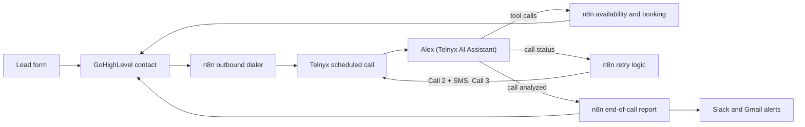

# SunPath Solar: Speed-to-Lead Voice Agent

An outbound AI voice agent that calls new solar leads soon after they submit a form, qualifies them, and books a consultation. Built on Telnyx AI Assistants, n8n and GoHighLevel.

## What it does

- A new lead lands in GoHighLevel (GHL). n8n schedules the first call through Telnyx about two minutes later.
- "Alex", the outbound assistant, confirms the person, gives the AI and recording disclosures, and asks three qualifying questions: do they own the home, is the roof theirs (not condo or HOA controlled), and is the monthly electricity bill $100 or more.
- Qualified leads are offered real calendar slots and booked into GHL.
- If nobody answers, the system calls again after 5 minutes and sends a text, then makes a third call 12 hours later.
- After every call, n8n reads the call analysis, writes the outcome to GHL, adds a note, and alerts the team on Slack and Gmail.
- A second assistant handles leads who call back.

## How it works



## What's in this repo

```
assistants/   Telnyx assistant configs (outbound and inbound callback)
prompts/      Full system prompts for both assistants
n8n/          The n8n workflow (224 nodes, one canvas)
docs/         Requirements, outcome routing, notification templates and the caller-facing security docs
```

## Stack

| Layer | Tool |
|---|---|
| Phone, speech and AI | Telnyx AI Assistants (model `moonshotai/Kimi-K2.6`, speech-to-text `deepgram/flux`) |
| Orchestration | n8n |
| CRM and calendar | GoHighLevel |
| Recovery state | Redis |
| Alerts | Slack, Gmail |

## Call outcomes

Every analyzed call ends in one of seven outcomes, each with its own GHL update, note and alert: `qualified_booked`, `qualified_not_booked`, `not_qualified`, `callback_requested`, `wrong_person`, `no_meaningful_conversation`, `do_not_call`. A lead who never answers three attempts is marked `exhausted`.

## Key design decisions

- **Scheduled events for outbound calls.** Calls are created through the Telnyx assistant `scheduled_events` endpoint, so each call carries its own settings. n8n checks the scheduled call's status afterwards and fires it again if it never ran.
- **Per-call dynamic variables.** Lead details reach the assistant through a per-call webhook, never by editing the assistant before a call. Editing a shared assistant would mix up details when two calls run at once.
- **Outcome comes from the call analysis.** A custom Telnyx insight returns the outcome, summary, sentiment and transcript in one pass. n8n finds it by its fixed insight ID, not by its position in a list.
- **Voicemail never changes the lead's status.** When answering-machine detection fires, a flag tells the end-of-call chain to skip the outcome write, so a voicemail cannot be scored as a real conversation. A separate note records every voicemail for the client.
- **Recovery when a webhook goes missing.** Each handled conversation is marked in Redis. A timed check pulls the conversation straight from the Telnyx API if the analysis webhook never arrives, and another check confirms Call 1 really fired.
- **Deterministic availability.** The tools that format open slots and check a requested time are Code nodes, not LLM calls, so the agent always reads back real slots.

## Caller-facing security

Four layers, documented in `docs/`:

1. **Prevention.** An Instruction Integrity section in both prompts (`docs/instruction-integrity.md`).
2. **Detection.** A post-call transcript scan for injection and manipulation attempts, with alerts (`docs/transcript-red-flag-scanning.md`). Tested on 10 synthetic cases and 37 real test-call transcripts: 0 false positives, 0 missed synthetic detections.
3. **Validation.** A scripted set of adversarial test calls (`docs/adversarial-test-script.md`).
4. **Containment.** n8n checks every booking parameter before it reaches the CRM, whatever the model sends (`docs/tool-call-validation.md`).

## Placeholders

| Placeholder | Replace with |
|---|---|
| `your-n8n-instance.example.com` | Your n8n base URL |
| `YOUR_WEBHOOK_PATH` | The webhook paths you choose |
| `YOUR_GHL_LOCATION_ID` | Your GHL location ID |
| `YOUR_GHL_CALENDAR_ID` | Your GHL calendar ID |
| `YOUR_GHL_USER_ID_1`, `YOUR_GHL_USER_ID_2`, `YOUR_GHL_USER_ID_3` | Your GHL staff user IDs |
| `YOUR_GHL_FIELD_ID_CALL_IN_PROGRESS`, `YOUR_GHL_FIELD_ID_CALL_NO_CONVERSATION`, `YOUR_GHL_FIELD_ID_LEAD_STATUS`, `YOUR_GHL_FIELD_ID_SOLAR_QUALIFIED` | Your GHL custom field IDs (the name says which field) |
| `YOUR_TELNYX_PHONE_NUMBER` | Your Telnyx phone number |
| `YOUR_TELNYX_OUTBOUND_ASSISTANT_ID` | Your Telnyx outbound assistant ID |
| `YOUR_TELNYX_INBOUND_ASSISTANT_ID` | Your Telnyx inbound assistant ID |
| `YOUR_TELNYX_ACCOUNT_SID` | Your Telnyx account SID (in the TeXML URLs) |
| `YOUR_TELNYX_INSIGHT_ID` | Your Telnyx call-analysis insight ID |
| `YOUR_TEXML_APP_ID` | Your TeXML application ID |
| `YOUR_SLACK_USER_ID` | The Slack user who gets the alerts |

## License

All rights reserved. Published for viewing only. See [LICENSE](LICENSE).
